# ConnectMe Community App

A Flutter community application built with Firebase, Clean Architecture, and Cubit state management.

## Features

- **Authentication:** Sign up and log in using Firebase Authentication.
- **Community Feed:** Create posts and retrieve posts in real time from Cloud Firestore.
- **User Profile:** Display profile photo, name, email, device model, and operating system version.
- **Profile Photo:** Select an image from the device gallery and save it to Firestore.
- **Biometric Authentication:** Protect access to the profile screen.
- **Community Map:** Display member locations across different cities using Google Maps.
- **State Management:** Manage authentication, posts, and profile state using Cubit.
- **Dependency Injection:** Register and manage dependencies using GetIt.
- **App Distribution:** Distribute a release APK to two testers using Firebase App Distribution.
- **Theme Management:** Centralize application colors and theme settings.

## Technologies Used

- Flutter and Dart
- Firebase Authentication
- Cloud Firestore
- Firebase App Distribution
- Flutter Bloc / Cubit
- GetIt
- Google Maps Flutter
- Local Auth
- Image Picker
- Device Info Plus

## Architecture

The project follows Clean Architecture to separate presentation, business logic, and data access.

```text
lib/
├── main.dart
├── injection.dart
├── core/
│   └── theme/
│       ├── app_colors.dart
│       └── app_theme.dart
├── data/
│   ├── datasources/
│   ├── models/
│   └── repositories/
├── domain/
│   ├── entities/
│   ├── repositories/
│   └── usecases/
├── Presentation/
│   ├── blocs/
│   ├── screens/
│   └── widgets/
└── services/
    ├── auth_service.dart
    ├── firestore_service.dart
    └── biometric_service.dart
```

*The tree shows the main architectural areas; additional files may exist in the project.*

### Design Patterns

- **Singleton Pattern:** Ensures a shared `FirestoreService` instance.
- **Factory Pattern:** Selects the appropriate post data source, such as remote Firestore or local cache.
- **Builder Pattern:** Constructs user profile objects through `UserModelBuilder`.
- **Dependency Injection:** GetIt manages dependencies and supports loose coupling between layers.

## Screenshots

Add your screenshots to the `screenshots/` directory.

### Authentication
<p align="center">
  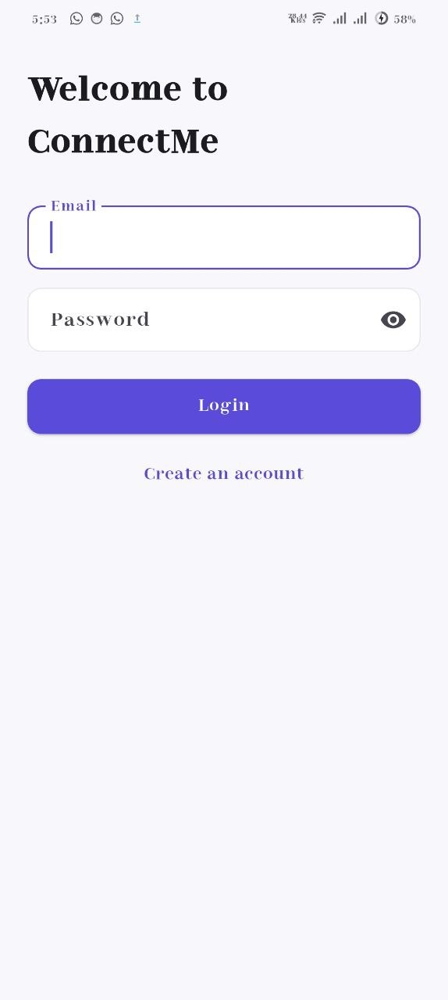
  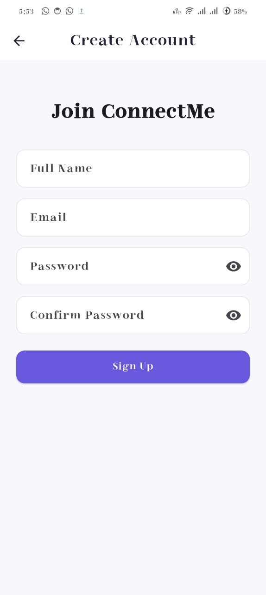
</p>

### Home Feed

<p align="center">
  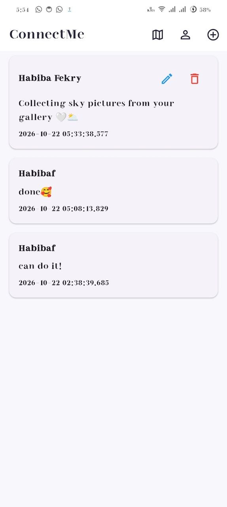
  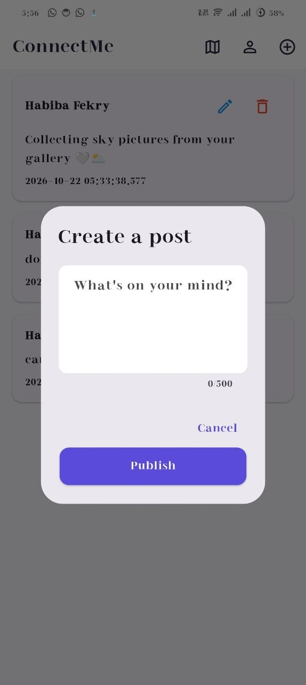
  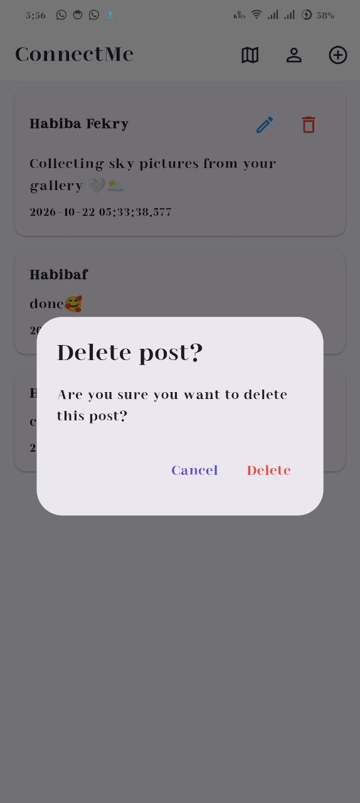
  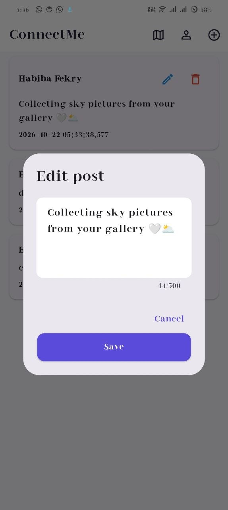
 
</p>


### User Profile

<p align="center">
  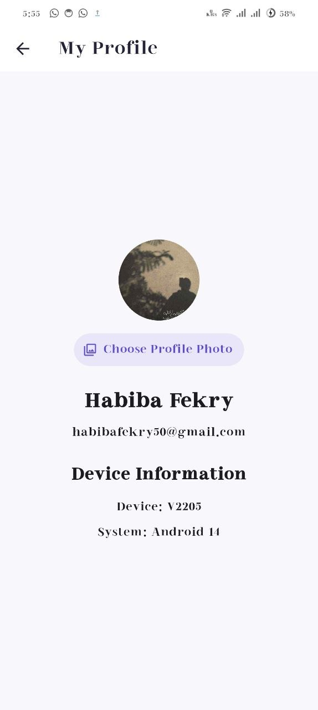
 
</p>

### Community Map

<p align="center">
  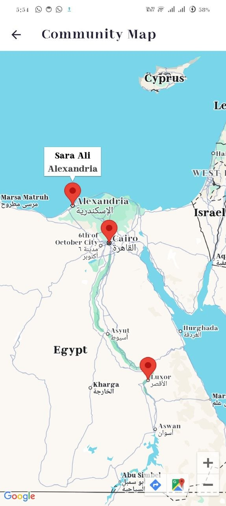
</p>

### Firebase App Distribution

**Release Dashboard**

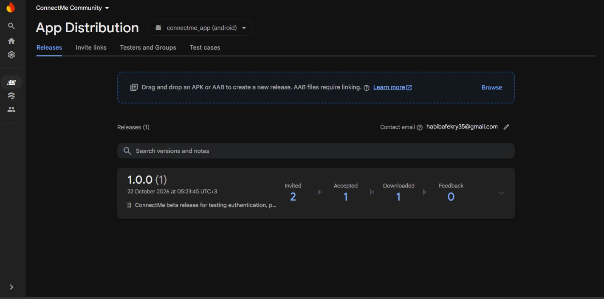

**Testers**

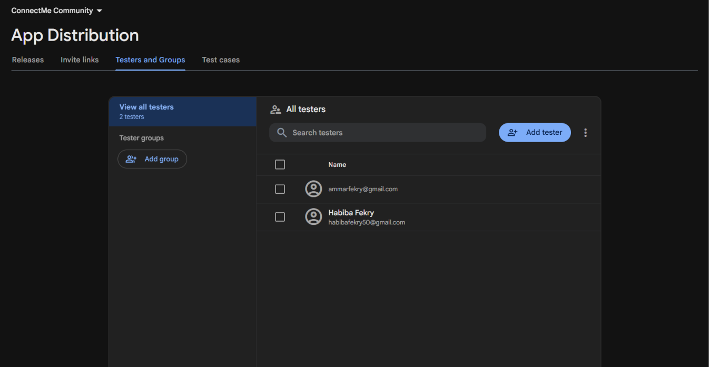

**Tester Invitation**

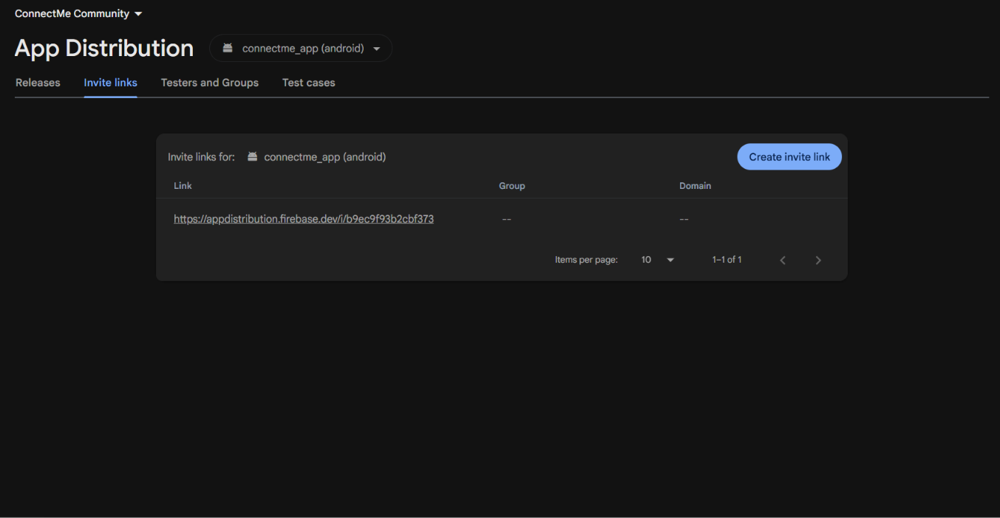

## Firebase Setup

1. Create a Firebase project.
2. Register the Android application in Firebase.
3. Configure Firebase for Flutter using FlutterFire CLI.
4. Enable Email/Password authentication.
5. Create a Cloud Firestore database and configure appropriate security rules.
6. Enable the Google Maps API and configure an API key.
7. Verify the required Android permissions and device configuration.

Ensure `firebase_options.dart` is generated for your Firebase project. Do not commit private credentials or unrestricted API keys.

## Installation and Usage

Clone the repository:

```bash
git clone https://github.com/YOUR_USERNAME/connectme_app.git
cd connectme_app
```

Install dependencies:

```bash
flutter pub get
```

Run the application:

```bash
flutter run
```

Build a release APK:

```bash
flutter build apk --release
```

The generated APK is located at:

```text
build/app/outputs/flutter-apk/app-release.apk
```

## Device Permissions

The application uses device capabilities for its profile and map features. Verify the final permissions against `AndroidManifest.xml` and the actual package configuration.

- **Internet:** Firebase services and map content.
- **Biometrics:** Local authentication before opening the profile.
- **Gallery / Image Access:** Selecting a profile photo.
- **Location:** Only required if current-device location is implemented.

Google Maps also requires a valid API key and appropriate API configuration.

## Firebase App Distribution

The release APK was uploaded to Firebase App Distribution for beta testing.

### Distribution Process

1. Build the release APK using Flutter.
2. Open Firebase Console and select the ConnectMe project.
3. Navigate to App Distribution.
4. Upload `app-release.apk`.
5. Add two tester email addresses.
6. Distribute the release to the testers.
7. Confirm that both testers received their invitations and installed the application.
8. Test the distributed build and capture screenshots for documentation.

### Beta Testing Status

- Release APK created successfully.
- APK uploaded to Firebase App Distribution.
- Two testers added.
- Both testers received invitations and installed the application.

## Quality Checks

Format Dart files:

```bash
dart format .
```

Analyze the project:

```bash
flutter analyze
```

Run tests, if configured:

```bash
flutter test
```

## Future Improvements

- Add more community interactions.
- Support dynamic member locations.
- Improve offline caching.
- Expand automated testing and error handling.

## Author

**ConnectMe Community App — V1.0**

Built as a Flutter capstone project focused on Firebase integration, Clean Architecture, native device features, design patterns, and beta distribution.
